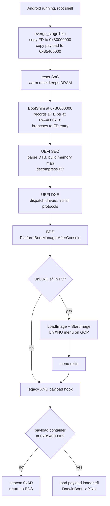

# Evergo UEFI / XNU

UEFI firmware and XNU boot chain for the **Redmi Note 11 5G** (Xiaomi `evergo`,
MediaTek MT6833 / Dimensity 810 class SoC).

This repository contains the device-specific work only: the UEFI platform
package, the boot shim, the patches applied to upstream EDK2/Mu, and the
tooling to build, deploy and diagnose the result. Upstream trees are fetched at
pinned revisions, not vendored.

> ## Verification status
>
> Read this before trusting anything else in this file.
>
> | Claim | Status |
> | --- | --- |
> | The firmware displays the real UniXNU menu on this device | **verified on hardware**, 2026-11-09, by the person who owns the phone |
> | The tree in this repository rebuilds to that same firmware | **verified**, but only on the machine it was developed on |
> | The documented workflow works from a clean clone on macOS | **verified** |
> | The documented workflow works from a clean clone on Linux | **verified on Linux aarch64** (Ubuntu 20.04 container): fetch-deps, build, 2 MiB FD produced. Used distro clang 18 instead of the NDK; see §5. |
> | **The documented workflow works on a second, independent machine** | **NOT verified.** This is the open question. |
> | Windows 11 + WSL2 | **not tested at all.** Instructions exist and follow the verified Linux path. |
> | XNU boots | **no.** See "Not working" below. |
>
> No claim here says "reproduced on another machine", because it has not been.
> If you are the first to try, see §4 for what is and is not expected to work.

---

## 1. Project overview

### What this is

A port of the [Project Silicium](https://github.com/Project-Silicium/Mu-Silicium)
UEFI firmware to a phone Silicium does not support, plus an integration of the
[UniXNU](https://github.com/UniXNU/UniXNU) boot manager as the UEFI boot menu.
The chain runs:

```
Android (unmodified, booted normally)
  -> evergo_stage1.ko   kernel module, copies image into reserved DRAM
  -> BootShim           copies the FD to 0xB0000000, jumps
  -> UEFI SEC           memory map, decompresses the firmware volume
  -> UEFI DXE / BDS     dispatches drivers, installs protocols
  -> UniXNU             graphical boot menu on the GOP framebuffer
  -> DarwinBoot         (upstream, provided by UniXNU) XNU handoff
  -> XNU                Apple kernel
```

### Verified on hardware

These are the only claims backed by observation on a real device. Everything
else in this document is design intent, static analysis or work in progress.

| Capability | Evidence |
| --- | --- |
| Android hot-jump into UEFI | firmware executes, SEC/DXE/BDS progress beacons advance |
| UEFI display output | the Silicium banner and the firmware's own console render |
| **UniXNU graphical menu** | video: real UniXNU `0.1.0` UI, `built-in configuration`, four entries (`Return to firmware`, `Restart`, `Power off`, `Tools`), running countdown |
| Framebuffer through GOP | menu renders at the device's native 1088x2400 portrait geometry |

The menu screenshot milestone is what "working" means in this repository. The
exact build that produced it is preserved in `docs/BASELINE.md` and is
reproducible from this tree.

### Not working

| Item | State |
| --- | --- |
| XNU kernel boot | **does not run.** No kernel entry, no `Darwin Kernel Version` output, no console from XNU. |
| Menu keyboard input | **does not work.** The menu displays `No input device`; volume/power keys do not move the highlight. |
| Boot entries in the menu | none. The menu shows `no boot entry found` because no payload volume is published to it. |
| Display in XNU | untested; nothing reaches XNU to test it |
| ACPI | placeholder tables inherited from another device |
| Storage (UFS) | no UFS DXE driver; the firmware cannot read the userdata partition |
| USB / charging / modem / camera | not implemented |

**Displaying the menu is not the same as booting iOS.** The UniXNU menu is a
UEFI application drawn by UEFI's own GOP; it runs entirely inside the firmware,
before any Apple code executes. Treat it as proof that the firmware, the
framebuffer and the boot-manager integration work, and nothing more.

### Why the menu milestone matters anyway

Getting a real boot manager on screen required solving the parts of the port
that are specific to this device and that no upstream project covers:

* a working hot-jump path that does not touch any partition,
* a memory map that survives the jump with the MMU on,
* a framebuffer path that reaches the panel from UEFI,
* an EDK2 package layout that lets a boot manager application be dispatched
  from the firmware volume.

Those are the reusable pieces. The XNU side is the open problem.

---

## 2. Boot architecture

### How the device normally boots

`evergo` is a MediaTek device. The stock chain is:

```
BootROM -> preloader -> LK (little kernel) -> boot.img (Linux) -> Android
```

LK reads the Android boot image, decompresses the kernel, and jumps to it with
the DTB pointer in `x0`. Nothing in this project replaces any of those stages,
and no partition is modified by the default workflow.

### How this project enters UEFI

The device already runs Linux. Instead of replacing the bootloader, a kernel
module performs a **hot jump**: it copies a payload into DRAM regions the
device's own device tree marks as reserved, then resets the SoC so the
preloader/LK path is skipped and control lands on our code.



### Components and what each one does

| Component | Path | Role |
| --- | --- | --- |
| `evergo_stage1` | not in this repo (device-side `.ko`) | copies the image into reserved DRAM, resets the SoC |
| `BootShim` | `BootShim/BootShim.S` | position-independent entry: records the DTB pointer, copies the FD to its link address, jumps |
| SEC | `Silicon/Silicium/SiliciumPkg/Sec` | first C code; builds the memory map from `MemoryMapLib`, decompresses the FV, enters DXE |
| evergo platform | `Platforms/Xiaomi/evergoPkg` | DSC/FDF, memory map, keypad library, board drivers |
| BootManagerLib | `Silicon/Silicium/SiliciumPkg/Library/BootManagerLib` | BDS policy: launches UniXNU first, then the XNU payload hook |
| UniXNUPkg | fetched from upstream | the menu application, boot-entry model, DarwinBoot |
| XNU loader hook | `BootManagerLib/XnuLoader.c` | finds an XNUP container in the payload window, loads and starts its loader |

### Memory layout

The addresses below are the ones the verified build uses. They are declared in
`Platforms/Xiaomi/evergoPkg/Library/MemoryMapLib/MemoryMapLib.c` and mirrored in
the shim and the loader; changing one without the others produces a silent
hang, because the UART is disabled in this build.

```text
0x40000000  System RAM base
0xB0000000  UEFI FD          (2 MiB, inside DTB no-map slot uefi-fd@B0000000)
0xB0200000  UEFI stack       (256 KiB, immediately after the FD)
0xB0300000  TRC trace ring   (64 KiB)
0xB5400000  XNUP payload     (16 MiB window, no-map)
0x4811FC00  beacon page      (32 x u64, survives a warm reset)
0x4811F800  TRC record ring  (2 KiB)
0xA40007F8  DTB pointer slot the shim writes for the firmware
```

The beacon page and TRC ring sit inside the reserved ramoops window declared by
the device's own DTB, which is why the Android kernel does not clear them
before the module reads them back. They are diagnostic channels, not an
interface.

### Device tree handling

The DTB is passed to the firmware by the shim through a fixed slot, and SEC
parses it for the memory reservations that must be preserved (the payload
window, the FD slot, the framebuffer). `Resources/DTBs/evergo.dtb` is the
unmodified FDT extracted from the device's stock boot image. LK runtime fixups
have not been re-verified against it, so treat the DTB as "the device's own
description, as shipped", not as something this project authored.

---

## 3. Repository structure

```
.
├── README.md                    this file
├── deps.lock                    pinned upstream revisions
├── LICENSE                      BSD-2-Clause-Patent (inherited from upstream)
├── CREDITS.md                   who wrote what, upstream attribution
├── .gitignore
├── Platforms/Xiaomi/evergoPkg/  the device platform package (our code)
│   ├── evergo.dsc               platform description, module list
│   ├── evergo.fdf               firmware volume layout
│   ├── Include/DXE.inc          DXE module list for the FV
│   ├── Include/APRIORI.inc      dispatch order
│   ├── Library/MemoryMapLib/    the memory map above
│   ├── Library/KeypadDeviceLib/ keypad abstraction (see limitations)
│   ├── Drivers/CamelliaBootMemoryDxe/  framebuffer bring-up and test pattern
│   ├── Drivers/CamelliaRamDiskDxe/     RAM-disk publication for the payload
│   ├── Drivers/CamelliaUniXNULoaderDxe/ legacy payload loader entry
│   ├── Drivers/EvergoBootFromRamDiskDxe/ boot the payload from RAM
│   ├── DeviceBuild.py           image assembly helper
│   └── PORTING-evergo.md        bring-up notes and known placeholders
├── Silicon/                     evergo-specific changes to upstream drivers
│   ├── Silicium/SiliciumPkg/Sec/            SEC entry, exceptions, module entry
│   ├── Silicium/SiliciumPkg/Library/BootManagerLib/  BDS policy + XNU hook
│   ├── Silicium/SiliciumPkg/Drivers/        SimpleFbDxe, KeypadDxe, KeypadDeviceDxe
│   └── MediaTek/MediaTekPkg/Drivers/        GpioDxe, PmicWrapperDxe, MT6358PmicDxe
├── BootShim/                    shim assembly and its Makefile
├── Resources/
│   ├── Configs/evergo.toml      board configuration for the payload packer
│   ├── DTBs/evergo.dtb          the device's own FDT
│   └── Scripts/mkbootimg.py     boot image packer
├── patches/
│   └── 0001-evergo-mu_basecore.patch   our changes to Microsoft Mu
├── scripts/
│   ├── fetch-deps.sh            clone + pin + patch + overlay
│   ├── build.sh                 build the FD
│   ├── build-shim.sh            build BootShim.bin
│   ├── make-boot-image.sh       wrap FD + shim + DTB into a boot image
│   ├── deploy.sh                push to the phone (device-touching)
│   └── decode-beacons.py        decode the beacon page and TRC ring
└── docs/
    ├── BASELINE.md              what the verified build is, and how it was proven
    ├── RUNBOOK.md               step-by-step device procedure
    └── TROUBLESHOOTING.md       symptoms, causes, what each one proves
```

Files under `Silicon/` and `BootShim/` are *modified upstream files*, kept here
as whole files for reviewability and overlaid onto the fetched tree by
`scripts/fetch-deps.sh`. Everything under `Platforms/` is written for this port.

---

## 4. Requirements and dependencies

### What has actually been tested

This matters more than a support matrix, so it comes first.

| Environment | State |
| --- | --- |
| macOS 15 (Apple silicon), full workflow | **verified**: fetch, build, image packaging, baseline comparison |
| Linux aarch64 (Ubuntu 20.04 container), fetch + build | **verified**: same source, same module inventory |
| Windows 11 + WSL2 | **not tested.** Instructions below are written from the Linux path, which is the same environment, but nobody has run it yet. |
| Native Windows (cmd/PowerShell) | **not supported.** The build is a POSIX shell + EDK2 workflow. |

If you are the first to run this on WSL2 and something fails, that is expected
and useful: please record which step and what the error was.

### Host requirements

| Requirement | Notes |
| --- | --- |
| Python | **3.8 or newer.** 3.8 is the interpreter in stock Ubuntu 20.04 and WSL2 images, and the scripts are written to that floor. |
| git | 2.25 or newer. `fetch-deps.sh` uses `--filter=blob:none`; older git ignores the flag rather than failing. |
| GNU make | any |
| curl or wget | to download the NDK if you do not already have it |
| C/C++ compiler + libuuid headers | `build-essential uuid-dev` on Debian/Ubuntu. EDK2 builds its own base tools on first use and needs both. `build.sh` checks and names the packages if missing. |
| **Android NDK r26 or newer** | **required, and not optional.** Supplies `clang`, `lld` and `llvm-objcopy`. A distribution clang will not work: the build targets `aarch64-unknown-windows-msvc` and needs the NDK's linker. Verified with r30 (`30.0.16248370`); r27c also works. |
| adb + fastboot | only for deployment to the phone |
| disk | ~2 GB for the fetched tree, ~4 GB with build output |

The EDK2 base tools are built from the fetched Mu tree on first use, so no
separate EDK2 installation is needed. `iasl` is only required if you change
ACPI tables.

`build.sh` tells you where to get the NDK if it cannot find one, and accepts
`--ndk DIR` or `ANDROID_NDK_ROOT`.

### Upstream components

All pinned in [`deps.lock`](deps.lock), all fetched by `scripts/fetch-deps.sh`.
Nothing third-party is vendored in this repository.

| Component | Pinned revision | Why it is needed |
| --- | --- | --- |
| `stanveyjiang/uefi-camellia` | `46752be` | the MT6833 UEFI tree this port was built on |
| Microsoft `mu_basecore` | `3c9c7b2` | EDK2 core; `patches/0001` targets exactly this commit |
| `mu_plus`, `mu_oem_sample` | `b8d46c7`, `b70b4b7` | DSC include chain |
| `Device-Binaries` | `a1501e0` | MT6833 prebuilt blobs (DDR, PLL, PMIC) |
| `Silicium-ACPI` | `1c8bd63` | ACPI table generators |
| `openssl` | `67b5686` | linked by `OpensslPkg` |
| UniXNU | `d3de950` | `UniXNUPkg`: the boot menu |

`deps.lock` is the single source of truth. If upstream moves, the pinned
revisions still build, and `fetch-deps.sh` fails loudly if a pin cannot be
obtained rather than building something else.

### Windows: use WSL2

The build needs a POSIX shell, GNU make and EDK2's Python tools. Run it inside
WSL2, not in PowerShell.

```powershell
# In an elevated PowerShell, once:
wsl --install -d Ubuntu-22.04
```

Then, inside the Ubuntu shell:

```bash
sudo apt update
# build-essential and uuid-dev are required by EDK2's C base tools:
# GenFv includes <uuid/uuid.h>, and VfrCompile needs a C++ compiler.
sudo apt install -y build-essential uuid-dev git make python3 curl unzip xz-utils

# Keep the checkout and the NDK inside the Linux filesystem.
# Building under /mnt/c is roughly an order of magnitude slower because every
# file access crosses the Windows boundary, and EDK2 does a lot of them.
cd ~
git clone https://github.com/hewei2723/Redmi-Note-11-5G-evergo-Xnu.git
cd Redmi-Note-11-5G-evergo-Xnu

# Android NDK, Linux build, inside WSL2:
curl -LO https://dl.google.com/android/repository/android-ndk-r30-linux.zip
unzip -q android-ndk-r30-linux.zip
export ANDROID_NDK_ROOT="$PWD/android-ndk-r30"

scripts/fetch-deps.sh
scripts/build.sh --tree .work/uefi
```

Notes specific to WSL2:

* **Keep everything in the Linux filesystem** (`~/...`). A checkout under
  `/mnt/c/Users/...` works but is very slow, and file-mode changes (the
  executable bit on `scripts/*.sh`) may be lost.
* If `scripts/*.sh` lost their executable bit (visible as `Permission denied`),
  either run `chmod +x scripts/*.sh` or invoke them as `bash scripts/build.sh`.
* **Deployment from WSL2 to a phone** needs USB passthrough, which WSL2 does not
  provide by default. Two options:
  - install Windows `platform-tools` and run `adb`/`fastboot` from PowerShell,
    passing `--image` to the image built inside WSL2 (paths are visible as
    `/mnt/c/...` from WSL2 and `C:\\...` from Windows), or
  - use `usbipd-win` to attach the device to WSL2.
  Building and verifying the firmware does not need the phone; only deployment
  does.
* Native Windows is not supported. Nothing here is written for `cmd.exe` or
  PowerShell.

---

## 5. Build instructions

### Step 1 — fetch dependencies

```bash
git clone https://github.com/hewei2723/Redmi-Note-11-5G-evergo-Xnu.git
cd Redmi-Note-11-5G-evergo-Xnu
scripts/fetch-deps.sh
```

This clones the UEFI base into `.work/uefi`, pins every submodule, applies
`patches/0001-evergo-mu_basecore.patch`, overlays `Platforms/` and `Silicon/`,
and installs `UniXNUPkg` from the pinned UniXNU revision. It is idempotent.
Expect a few hundred MB and several minutes.

### Step 2 — build the firmware

```bash
scripts/build.sh --tree .work/uefi
```

The script always passes the hot-jump geometry explicitly:

```text
FD_BASE=0xB0000000  FD_SIZE=0x200000  FD_BLOCKS=0x200
```

A plain `build` with the DSC defaults links the FD for the cold-boot address
`0x40080000` and will fault the moment the MMU comes on. Do not bypass the
script.

Output: `out/SILICIUM_UEFI.fd`, exactly 2 MiB.

### Step 3 — build the shim

```bash
scripts/build-shim.sh --tree .work/uefi
```

Output: `out/BootShim.bin`. The shim is assembled for the payload size you pass
(`--payload-size`); with no payload it only copies the FD.

### Step 4 — package a boot image

```bash
scripts/make-boot-image.sh \
  --fd   out/SILICIUM_UEFI.fd \
  --shim out/BootShim.bin \
  --dtb  .work/uefi/Resources/DTBs/evergo.dtb \
  --out  out/evergo-boot.img
```

The script re-opens what it wrote and compares the kernel region and DTB byte
for byte, so a packaging bug fails here rather than on the phone.

To make LK's own header validation happy on your unit, pass
`--header-template stock-boot_b-header.bin` — the first 2048 bytes of the stock
`boot_b` image for your exact model, which carries the load addresses.

### Verifying a build

A successful build produces `out/SILICIUM_UEFI.fd`, exactly 2097152 bytes. That
size check is the first thing to confirm; a different size means the hot-jump
`-D` flags were lost.

To compare against the verified baseline:

```bash
scripts/compare-baseline.py --fd out/SILICIUM_UEFI.fd --baseline baseline-FVMAIN.Fv
```

**What a comparison can and cannot tell you depends on your compiler**, and this
was measured, not assumed:

| Build | Result vs. the macOS/clang-18 baseline |
| --- | --- |
| same machine, same toolchain, same path length | 57/57 modules byte-identical |
| same machine, same toolchain, different path length | 46 identical, 11 layout-only, 0 code |
| **Linux aarch64, distro clang 18.1.8** | 6 identical, **51 code-different** |

The third row is not a regression. A different clang version emits different
instructions for the same source, so cross-toolchain comparison cannot prove
equivalence either way. Treat "code differs" as **not comparable** unless both
builds used the same compiler.

Two further effects, both measured:

* **Build path length.** The compiler embeds each module's PDB path in
  `.rdata`; a different path length shifts that string and the ADRP/ADD
  immediates addressing it. Same-length path gives byte-identical output.
* **Toolchain version.** Anything from clang 18 upwards compiles this tree.
  clang 11 fails in `ArmMmuLib`'s assembly (`symbol ... can not be undefined in
  a subtraction expression`) and clang 10 additionally fails the `-Wformat`
  checks in `MdePkg`'s `UefiLib`. That is why the NDK is a hard requirement
  rather than a convenience.

So: use the size check and a successful build as your correctness signal on a
new machine. Use `compare-baseline.py` for same-toolchain regression checks
after you change something.

---

## 6. Booting UEFI and XNU on Evergo

Read [`docs/RUNBOOK.md`](docs/RUNBOOK.md) for the full procedure with the exact
commands and stop conditions. This section is the map; that file is the detail.

### 6.1 Confirm the device

```bash
adb shell getprop ro.product.device      # must print: evergo
adb shell getprop ro.product.model       # Redmi Note 11 5G
```

If `ro.product.device` is not `evergo`, stop. This firmware is for one device.

### 6.2 Prerequisites

| Requirement | How to check |
| --- | --- |
| Bootloader unlocked | `fastboot oem device-info` (needs fastboot mode) |
| Root, with `su` usable from `adb shell` | `adb shell su -c id` prints `uid=0` |
| `evergo_stage1.ko` on the device | `/data/adb/evergo_stage1.ko` |
| Kernel module loading allowed | `adb shell su -c 'lsmod'` succeeds |

The module is device-side tooling that is not part of this repository. Without
it the hot-jump path cannot run; see [`docs/RUNBOOK.md`](docs/RUNBOOK.md) for
what it must do, so you can build or obtain an equivalent.

### 6.3 Deploy and start

```bash
# never writes a partition
scripts/deploy.sh --image out/evergo-boot.img --serial <serial> --yes --read-back
```

The phone's screen is the only output for the firmware stage: `adb` is gone the
moment the jump happens. Watch for, in order:

1. a full-screen colour-bar test pattern (SEC has taken over the framebuffer),
2. the UniXNU menu with a moving countdown,
3. either the menu waiting for input, or a reset back to Android.

### 6.4 Reading the result

After the device returns to Android:

```bash
scripts/deploy.sh --image out/evergo-boot.img --serial <serial> --yes --read-back
```

or decode a dump you already have:

```bash
scripts/decode-beacons.py --beacon beacon.bin --trace trace.bin
```

The decoder prints the last stage the firmware reached. Interpretation rules —
these matter, because a zeroed page is *not* evidence that code did not run:

| Reading | What it proves |
| --- | --- |
| beacon magic present, stage `0xA2` | SEC and DXE dispatch completed |
| stage `0xA3` | BDS reached `AfterConsole`; the UniXNU launch point |
| stage `0xAD` | the XNU hook ran and found no payload container |
| stage `0xAE` | a container was found and its loader was started |
| slot 17 bit 63 set | `XnuLoaderMain` returned in this run |
| magic missing / all `0xFF` | the page was overwritten — proves nothing either way |

### 6.5 What "XNU reached a stage" requires

The menu appearing does **not** mean XNU ran. The distinction:

* menu visible → UEFI + UniXNU executed (verified)
* `0xAD` → the loader hook executed (verified in earlier runs)
* `0xAE` → a payload container was found (observed)
* DarwinBoot printing anything → not observed
* `Darwin Kernel Version` on a console → **not observed**

### 6.6 Risk and recovery

| Operation | Risk | Recovery |
| --- | --- | --- |
| `deploy.sh` (default) | the phone resets; DRAM-only change | power-cycle. No partition changed. |
| `deploy.sh --flash` | **can brick** boot_b | `fastboot flash boot_b <stock image>`, needs an unlocked bootloader and the stock image on hand |
| changing memory map addresses | silent hang, no output | revert the change; the beacon page tells you how far it got |

The default path never writes a partition. Use `--flash` only if you have the
stock `boot_b` image on the same machine and know how to flash it.

---

## 7. Troubleshooting

Full symptom/cause table in [`docs/TROUBLESHOOTING.md`](docs/TROUBLESHOOTING.md).
The short version:

| Symptom | Most likely cause | What it does *not* mean |
| --- | --- | --- |
| Build fails in `fetch-deps.sh` patch step | upstream revision moved | your toolchain is broken |
| `build` cannot find `evergoPkg` | `--tree` points at the wrong directory | the DSC is wrong |
| FD is not 2 MiB | build ran without the hot-jump `-D` flags | the firmware is corrupt |
| Black screen after jump, no colour bars | SEC did not reach the framebuffer, or the FD is linked for the wrong base | the display is broken |
| Colour bars, then black | DXE or BDS died after SEC; check the beacon stage | XNU ran and crashed |
| Menu appears, no keys work | no `SimpleTextIn` device reached `gST->ConIn`; expected in the verified build | the menu is broken |
| Menu appears, then resets | countdown expired into `Return to firmware`, which exits into a failing hook and a watchdog reset | the firmware is unstable |
| Beacon page all `0xFF` or `0x00` | the page was overwritten by the Android kernel | the firmware did not run |

A rule that repeatedly saved time on this project: **fix the measurement before
believing the measurement.** Several early "the loader never ran" conclusions
turned out to be a reader reading the wrong offset, or a cache-clean at a
different address than the write.

---

## 8. Using this repository with AI coding agents

Copy the block below into Codex, Claude Code, or any agent with shell access to
a checkout of this repository on a machine with an `evergo` attached. It is
written to be self-contained.

```text
You are helping port UEFI and XNU to a Xiaomi Redmi Note 11 5G (device codename
`evergo`, MediaTek MT6833). The repository you are in is the device-specific
part of that port: the UEFI platform package, a boot shim, patches against
upstream EDK2/Mu, and tooling. Read this whole prompt before acting.

STEP 0 - UNDERSTAND BEFORE CHANGING ANYTHING
1. Read README.md completely, then docs/BASELINE.md, docs/RUNBOOK.md and
   docs/TROUBLESHOOTING.md.
2. Read deps.lock, scripts/fetch-deps.sh and scripts/build.sh so you know what
   gets fetched, what gets patched, and how the FD is linked.
3. Read Platforms/Xiaomi/evergoPkg/evergo.dsc and evergo.fdf to learn which
   modules end up in the firmware volume, and
   Platforms/Xiaomi/evergoPkg/Library/MemoryMapLib/MemoryMapLib.c for the
   address map.
4. Read Silicon/Silicium/SiliciumPkg/Library/BootManagerLib/BootManager.c to
   see the exact BDS policy: UniXNU is launched first, then the XNU payload
   hook.

Then state, in your own words and before touching any file:
- what is verified working (UniXNU menu renders on the panel),
- what is not (XNU does not boot; menu input does not work; no boot entries),
- what the beacon page and TRC ring are for, and why a zeroed page is not proof
  that code did not run.
If you cannot state these accurately, re-read; do not proceed on assumption.

STEP 1 - RECOGNISE THE DEVICE AND ITS HARDWARE
Confirm with `adb shell getprop ro.product.device` that the attached device is
`evergo`. Do not assume another MediaTek device behaves the same: the GIC
redistributor wake-up, the PMIC register offsets, the display subsystem and the
keypad controller all differ between MTK SoCs. Several comments in this tree
record values measured on THIS device; do not "correct" them from generic
MT6833 documentation, and do not generalise them to other devices.

STEP 2 - BUILD ENVIRONMENT
1. Check for python3, git, make, an Android NDK with clang/lld, and adb. Report
   versions.
2. If the NDK is missing, tell the user which version deps.lock expects and
   stop; do not substitute a random toolchain and call the result verified.
3. Run `scripts/fetch-deps.sh`. If a patch fails to apply, that means the
   upstream revision moved - report it and stop rather than hand-editing
   third-party sources to make it fit.
4. Run `scripts/build.sh --tree .work/uefi`. Confirm the FD is exactly 2 MiB.
   If the build script reports a different size, the hot-jump flags were lost.

STEP 3 - DEPLOY AND OBSERVE, WITH THE USER'S PERMISSION
Deploying changes device state and needs an unlocked bootloader and root. Before
running scripts/deploy.sh:
- explain exactly what it will do (hot jump by default; no partition is
  written),
- say what you expect to appear on the screen and in which order,
- get explicit confirmation from the user.
Never run `deploy.sh --flash` unless the user has the stock boot_b image on the
same machine and explicitly asks for it. Say plainly that it can brick the
phone.

After each run, read the beacon page and decode it. Report:
- the last stage reached, as a number and a meaning,
- which stages you did NOT observe,
- whether the reading is trustworthy (magic present?) or void.
Never describe "the menu appeared" as "XNU booted".

STEP 4 - DEBUGGING RULES THAT THIS PROJECT LEARNED THE HARD WAY
- Fix the measurement before trusting it. If a value looks like proof that
  something did not run, first verify the write address, the read address, the
  cache maintenance address and the offset used by the reader all agree.
- Prefer a single unambiguous run over a sweep of speculative changes. Change
  one thing, then re-measure.
- Distinguish "did not execute" from "executed and read zero". A stage marker
  written by the code you are testing is what separates them.
- Do not treat compiler success as boot success. A clean build says nothing
  about whether the firmware reaches BDS.
- Do not treat a rendered image as evidence of kernel progress. UEFI drawing an
  icon and XNU printing to a console are different layers; say which one you
  observed.
- If you add diagnostics, put them behind a build define (see the pattern used
  for EVERGO_INPUT_DIAG style gates) so the shipping path stays clean, and give
  every round a unique marker so stale data cannot be mistaken for fresh data.

STEP 5 - MAKING CHANGES
- Reuse what is here. BootManagerLib, MemoryMapLib and the shim already encode
  decisions that took real hardware time to get right; rewriting them from
  scratch will re-introduce faults.
- Any change to an address in MemoryMapLib must be mirrored in BootShim, the
  loader hook and the payload window constants. Search for the constant; do not
  assume one place.
- Keep the verified baseline reachable: the branch/tag recorded in
  docs/BASELINE.md must keep building and must keep reproducing the menu. If a
  change breaks it, say so and offer to revert.
- When you finish a step, write down what you verified, what you did not, and
  what the next person should try. Do not claim a stage you did not observe.

STEP 6 - WHAT TO WORK ON NEXT
The highest-value open problems, in order:
1. Menu input. The menu reports "No input device". Work out why no
   SimpleTextIn handle with a device path reaches the console, without breaking
   the menu display that currently works.
2. Publishing a boot entry so the menu stops saying "no boot entry found".
3. Getting a payload container to survive from the module into the loader hook
   so the XNU path can be exercised.
4. Only then: XNU early boot itself.

Report progress honestly. If you are blocked, say what evidence you are missing
and what experiment would produce it, rather than guessing at a cause.
```

---

## 9. Project status and provenance

* Verified baseline: see [`docs/BASELINE.md`](docs/BASELINE.md) for the exact
  commit, the module inventory, and how the menu milestone was confirmed.
* Attribution and licences: [`CREDITS.md`](CREDITS.md).
* This is a development snapshot, not a release. It boots a menu, not an OS.

## 10. Licence

The port follows the licence of the upstream it derives from:
**BSD-2-Clause-Patent**, see [`LICENSE`](LICENSE). Individual upstream
components keep their own terms; [`CREDITS.md`](CREDITS.md) lists them
component by component.
