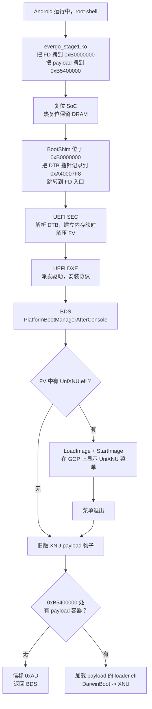

# Evergo UEFI / XNU

中文 | [**English**](README.md)

面向 **Redmi Note 11 5G**（小米代号 `evergo`，联发科 MT6833 / 天玑 810 级别 SoC）的
UEFI 固件与 XNU 启动链。

本仓库只包含设备相关的部分：UEFI 平台包、启动 shim、施加到上游 EDK2/Mu 的补丁，
以及构建、部署、诊断所需的工具。上游代码树按固定版本拉取，不随仓库分发。

> ## 验证状态
>
> 在相信本文件的任何其他内容之前，请先读这一节。
>
> | 声明 | 状态 |
> | --- | --- |
> | 固件在本设备上显示出真正的 UniXNU 菜单 | **已在真机验证**，2026-11-09，由设备持有者确认 |
> | 本仓库的代码树能重新构建出同一份固件 | **已验证**，但仅在开发它的那台机器上 |
> | 文档所述流程在 macOS 上从全新克隆可用 | **已验证** |
> | 文档所述流程在 Linux 上从全新克隆可用 | **已验证**，两次，在干净的 Ubuntu 20.04 容器中：文档中的四条命令全部成功，未附加任何文档之外的参数 |
> | BootShim.bin 跨平台完全一致 | **已验证**：macOS 与 Linux 上 sha256 均为 `26c74d4e...` |
> | **文档所述流程在第二台独立机器上可用** | **未验证。** 到目前为止的全部验证都在同一台机器及其容器中完成。 |
> | Windows 11 + WSL2 | **完全未测试。** 说明是依照已验证的 Linux 路径写的，但没人在 Windows 上跑过。 |
> | `stage1/` 模块源码就是产生已验证那次运行的源码 | **未验证。** 它确实是确认菜单时磁盘上的那份源码，但当时运行的 `.ko` 是更早构建的；此后源码未重新构建、未重新上机验证。 |
> | Releases 中的预编译 `evergo_stage1.ko` 与本源码对应 | **已验证**：重新构建 `stage1/evergo_stage1.c` 可精确复现其 sha256 `bfd10375...` |
> | XNU 启动 | **否。** 见下文「尚未工作」。 |
>
> 本文件没有任何一处声称「已在另一台机器上复现」，因为确实还没有。
> 如果你是第一个尝试的人，请先看 §4 了解哪些该工作、哪些不应期待。

---

## 1. 项目概览

### 这是什么

把 [Project Silicium](https://github.com/Project-Silicium/Mu-Silicium) 的 UEFI 固件
移植到 Silicium 并不支持的一款手机上，并把
[UniXNU](https://github.com/UniXNU/UniXNU) 启动管理器集成为 UEFI 启动菜单。
整条链路是：

```
Android（未修改，正常启动）
  -> evergo_stage1.ko   内核模块，把 FD 拷入预留 DRAM
  -> BootShim           把 FD 拷到 0xB0000000，跳转
  -> UEFI SEC           建立内存映射，解压固件卷
  -> UEFI DXE / BDS     派发驱动，安装协议
  -> UniXNU             在 GOP 帧缓冲上绘制图形启动菜单
  -> DarwinBoot         （上游，由 UniXNU 提供）XNU 交接
  -> XNU                Apple 内核
```

### 已在真机验证的部分

以下这些是唯一有真机观测支撑的声明。本文件其余内容属于设计意图、静态分析或
进行中的工作。

| 能力 | 证据 |
| --- | --- |
| Android 热跳进入 UEFI | 固件执行，SEC/DXE/BDS 进度信标推进 |
| UEFI 显示输出 | Silicium 横幅与固件自带控制台能正常渲染 |
| **UniXNU 图形菜单** | 视频：真正的 UniXNU `0.1.0` 界面、`built-in configuration`、四个条目（`Return to firmware`、`Restart`、`Power off`、`Tools`）、倒计时在走 |
| 通过 GOP 输出帧缓冲 | 菜单以设备原生 1088x2400 竖屏几何渲染 |

菜单截图这一里程碑，就是本仓库里「可用」的含义。产生它的那次构建被完整记录在
`docs/BASELINE.md`，并且可从本代码树复现。

### 尚未工作

| 项目 | 状态 |
| --- | --- |
| XNU 内核启动 | **不运行。** 没有内核入口，没有 `Darwin Kernel Version` 输出，XNU 没有任何控制台输出。 |
| 菜单键盘输入 | **不工作。** 菜单显示 `No input device`；音量/电源键不能移动高亮项。 |
| 菜单中的启动项 | 无。菜单显示 `no boot entry found`，因为没有向它发布任何 payload 卷。 |
| XNU 中的显示 | 未测试；没有任何东西能到达 XNU 去测试 |
| ACPI | 从另一台设备继承的占位表 |
| 存储（UFS） | 没有 UFS DXE 驱动；固件无法读取 userdata 分区 |
| USB / 充电 / 调制解调器 / 相机 | 未实现 |

**显示出菜单不等于启动了 iOS。** UniXNU 菜单是一个 UEFI 应用，由 UEFI 自己的 GOP
绘制；它完全运行在固件内部，早于任何 Apple 代码执行。请把它当作「固件、帧缓冲、
启动管理器集成都能工作」的证据，仅此而已。

### 为什么这个菜单里程碑仍然重要

要让一个真正的启动管理器显示在屏幕上，必须解决这次移植中设备特有、且没有任何
上游项目覆盖的部分：

* 一条不触碰任何分区的可用热跳路径，
* 一份在 MMU 开启后仍能撑过跳转的内存映射，
* 一条能从 UEFI 打通到面板的帧缓冲路径，
* 一套能让启动管理器应用从固件卷被派发的 EDK2 包布局。

这些是可复用的部分。XNU 那一侧才是未解的问题。

---

## 2. 启动架构

### 设备正常如何启动

`evergo` 是一台联发科设备。原厂链路是：

```
BootROM -> preloader -> LK (little kernel) -> boot.img (Linux) -> Android
```

LK 读取 Android boot image，解压内核，并把 DTB 指针放在 `x0` 中跳转过去。
本项目的任何部分都不替换上述任一阶段，默认流程也不修改任何分区。

### 本项目如何进入 UEFI

设备已经在运行 Linux。我们不替换引导程序，而是由一个内核模块执行**热跳**：
它把一段 payload 拷入设备自身设备树标记为预留的 DRAM 区域，然后复位 SoC，
从而跳过 preloader/LK 路径，让控制权落到我们的代码上。



### 各组件及其职责

| 组件 | 路径 | 作用 |
| --- | --- | --- |
| `evergo_stage1` | `stage1/`（内核模块，单独构建） | 把 FD 拷入预留 DRAM，然后跳转进去 |
| `BootShim` | `BootShim/BootShim.S` | 位置无关入口：记录 DTB 指针，把 FD 拷到其链接地址，跳转 |
| SEC | `Silicon/Silicium/SiliciumPkg/Sec` | 第一段 C 代码；依据 `MemoryMapLib` 建立内存映射，解压 FV，进入 DXE |
| evergo 平台 | `Platforms/Xiaomi/evergoPkg` | DSC/FDF、内存映射、按键库、板级驱动 |
| BootManagerLib | `Silicon/Silicium/SiliciumPkg/Library/BootManagerLib` | BDS 策略：先启动 UniXNU，再走 XNU payload 钩子 |
| UniXNUPkg | 从上游拉取 | 菜单应用、启动项模型、DarwinBoot |
| XNU 加载钩子 | `BootManagerLib/XnuLoader.c` | 在 payload 窗口中查找 XNUP 容器，加载并启动其 loader |

### 内存布局

下列地址是已验证构建所使用的。它们在
`Platforms/Xiaomi/evergoPkg/Library/MemoryMapLib/MemoryMapLib.c` 中声明，并在 shim
和 loader 中镜像；只改其中一处而不改其余，会产生静默挂起，因为本次构建中 UART
是关闭的。

```text
0x40000000  系统 RAM 基址
0xB0000000  UEFI FD          （2 MiB，位于 DTB no-map 槽 uefi-fd@B0000000）
0xB0200000  UEFI 栈          （256 KiB，紧接 FD 之后）
0xB0300000  TRC 跟踪环       （64 KiB）
0xB5400000  XNUP payload     （16 MiB 窗口，no-map）
0x4811FC00  信标页           （32 个 u64，可跨热复位存活）
0x4811F800  TRC 记录环       （2 KiB）
0xA40007F8  shim 为固件写入的 DTB 指针槽
```

信标页和 TRC 环位于设备自身 DTB 声明的预留 ramoops 窗口内，这也是为什么 Android
内核在模块回读它们之前不会清空。它们是诊断通道，不是接口。

### 设备树处理

shim 通过一个固定槽把 DTB 传给固件，SEC 解析它以取得必须保留的内存预留
（payload 窗口、FD 槽、帧缓冲）。`Resources/DTBs/evergo.dtb` 是从设备原厂
boot image 中提取的、未经修改的 FDT。LK 的运行时修补尚未针对它重新验证，
因此请把这份 DTB 视为「设备出厂时的自我描述」，而非本项目编写的东西。

---

## 3. 仓库结构

```
.
├── README.md                    本文件
├── deps.lock                    固定的上游版本
├── LICENSE                      BSD-2-Clause-Patent（继承自上游）
├── CREDITS.md                   谁写了什么、上游署名
├── .gitignore
├── Platforms/Xiaomi/evergoPkg/  设备平台包（我们的代码）
│   ├── evergo.dsc               平台描述、模块清单
│   ├── evergo.fdf               固件卷布局
│   ├── Include/DXE.inc          FV 的 DXE 模块清单
│   ├── Include/APRIORI.inc      派发顺序
│   ├── Library/MemoryMapLib/    上文的内存映射
│   ├── Library/KeypadDeviceLib/ 按键抽象（见限制说明）
│   ├── Drivers/CamelliaBootMemoryDxe/  帧缓冲初始化与测试图案
│   ├── Drivers/CamelliaRamDiskDxe/     payload 的 RAM 盘发布
│   ├── Drivers/CamelliaUniXNULoaderDxe/ 旧版 payload 加载入口
│   ├── Drivers/EvergoBootFromRamDiskDxe/ 从 RAM 启动 payload
│   ├── DeviceBuild.py           镜像组装辅助脚本
│   └── PORTING-evergo.md        移植笔记与已知占位
├── Silicon/                     针对上游驱动的 evergo 专属改动
│   ├── Silicium/SiliciumPkg/Sec/            SEC 入口、异常、模块入口
│   ├── Silicium/SiliciumPkg/Library/BootManagerLib/  BDS 策略 + XNU 钩子
│   ├── Silicium/SiliciumPkg/Drivers/        SimpleFbDxe、KeypadDxe、KeypadDeviceDxe
│   └── MediaTek/MediaTekPkg/Drivers/        GpioDxe、PmicWrapperDxe、MT6358PmicDxe
├── BootShim/                    shim 汇编及其 Makefile
├── stage1/                      热跳内核模块（GPL-2.0）
│   ├── evergo_stage1.c          把 FD 拷入预留 DRAM 并跳转
│   ├── Makefile                 针对设备内核树的树外构建
│   └── README.md                如何构建，以及为何必须 LTO+CFI
├── Resources/
│   ├── Configs/evergo.toml      payload 打包器的板级配置
│   ├── DTBs/evergo.dtb          设备自身的 FDT
│   └── Scripts/mkbootimg.py     boot image 打包器
├── patches/
│   └── 0001-evergo-mu_basecore.patch   我们对 Microsoft Mu 的改动
├── scripts/
│   ├── fetch-deps.sh            克隆 + 固定 + 打补丁 + 覆盖
│   ├── build.sh                 构建 FD
│   ├── build-shim.sh            构建 BootShim.bin
│   ├── make-boot-image.sh       把 FD + shim + DTB 打包成 boot image
│   ├── deploy.sh                在手机上运行固件（会改动设备）
│   ├── compare-baseline.py      把一次构建与已验证基线比对
│   ├── decode-beacons.py        解码信标页与 TRC 环
│   └── lib.sh                   共享辅助函数（sha256、CPU 数）
└── docs/
    ├── BASELINE.md              已验证构建是什么，以及如何证明
    ├── RUNBOOK.md               逐步的设备操作流程
    └── TROUBLESHOOTING.md       症状、原因、每个症状能证明什么
```

`Silicon/` 与 `BootShim/` 下的文件是*被修改的上游文件*，在此以完整文件形式保留
以便审阅，并由 `scripts/fetch-deps.sh` 覆盖到拉取的代码树上。`Platforms/` 下的
所有内容都是为本次移植编写的。

---

## 4. 环境要求与依赖

### 实际测试过什么

这比一张支持矩阵更重要，所以放在最前面。

| 环境 | 状态 |
| --- | --- |
| macOS 15（Apple 芯片），完整流程 | **已验证**：拉取、构建、镜像打包、基线比对 |
| Linux aarch64（Ubuntu 20.04 容器），拉取 + 构建 | **已验证**：同一份源码，同一份模块清单 |
| Windows 11 + WSL2 | **未测试。** 下面的说明是依照 Linux 路径写的，环境相同，但还没人跑过。 |
| 原生 Windows（cmd/PowerShell） | **不支持。** 构建是 POSIX shell + EDK2 流程。 |

如果你是第一个在 WSL2 上运行的人且某处失败，这是预期之中、且有用的：请记录
是哪一步、报了什么错。

### 主机要求

| 要求 | 说明 |
| --- | --- |
| Python | **3.8 或更新。** 3.8 是原版 Ubuntu 20.04 与 WSL2 镜像自带的解释器，脚本按这个下限编写。 |
| git | 2.25 或更新。`fetch-deps.sh` 使用 `--filter=blob:none`；更旧的 git 会忽略该参数而非报错。 |
| GNU make | 任意版本 |
| curl 或 wget | 用于在你还没有 NDK 时下载它 |
| C/C++ 编译器 + libuuid 头文件 | Debian/Ubuntu 上为 `build-essential uuid-dev`。EDK2 首次使用时自行构建基础工具，两者都需要。缺失时 `build.sh` 会检查并指出包名。 |
| **Android NDK r26 或更新** | **必需，非可选项。** 提供 `clang`、`lld` 和 `llvm-objcopy`。发行版自带的 clang 不行：构建目标是 `aarch64-unknown-windows-msvc`，需要 NDK 的链接器。已用 r30（`30.0.16248370`）验证；r27c 也可用。 |
| adb + fastboot | 仅用于部署到手机 |
| 磁盘 | 拉取的代码树约 2 GB，含构建产物约 4 GB |

EDK2 基础工具在首次使用时从拉取的 Mu 树构建，因此无需单独安装 EDK2。
只有在你修改 ACPI 表时才需要 `iasl`。

`build.sh` 在找不到 NDK 时会告诉你从哪里获取，并接受 `--ndk DIR` 或
`ANDROID_NDK_ROOT`。

### 上游组件

全部固定在 [`deps.lock`](deps.lock)，全部由 `scripts/fetch-deps.sh` 拉取。
本仓库不随附任何第三方代码。

| 组件 | 固定版本 | 为何需要 |
| --- | --- | --- |
| `stanveyjiang/uefi-camellia` | `46752be` | 本次移植所基于的 MT6833 UEFI 树 |
| Microsoft `mu_basecore` | `3c9c7b2` | EDK2 核心；`patches/0001` 精确针对此提交 |
| `mu_plus`、`mu_oem_sample` | `b8d46c7`、`b70b4b7` | DSC include 链 |
| `Device-Binaries` | `a1501e0` | MT6833 预编译 blob（DDR、PLL、PMIC） |
| `Silicium-ACPI` | `1c8bd63` | ACPI 表生成器 |
| `openssl` | `67b5686` | 由 `OpensslPkg` 链接 |
| UniXNU | `d3de950` | `UniXNUPkg`：启动菜单 |

`deps.lock` 是唯一事实来源。若上游变动，固定版本仍能构建；若某个固定版本无法
获取，`fetch-deps.sh` 会明确报错，而不是去构建别的东西。

### 在新机器上的首次运行：会遇到什么

以下每一条都是实际做出来时学到的，每一条都曾是真实失败。

| 步骤 | 首次运行的典型开销 | 可能出什么问题 |
| --- | --- | --- |
| `fetch-deps.sh` | 5-20 分钟，磁盘约 1.5 GB | 网络。它克隆基础树、6 个一级子模块，以及 `Mu_Basecore` 内另外 9 个。它会从磁盘上已有的内容续传，所以连接中断后重跑即可。 |
| EDK2 基础工具构建 | 1-2 分钟，仅一次 | 缺 `build-essential` 或 `uuid-dev`。`build.sh` 会指出。 |
| `build.sh` | 首次之后约 30 秒 | FD 必须正好 2097152 字节；否则说明热跳 `-D` 参数丢了。 |
| `build-shim.sh` | 瞬时 | 需要 NDK。无论平台，输出都应为 304 字节、sha256 `26c74d4e...`。 |
| `make-boot-image.sh` | 瞬时 | 需要来自拉取代码树的 DTB，不能只用本仓库里的。 |

两件**不需要**、也不会有帮助的事：

* 系统级安装 EDK2 —— 代码树会自建工具；
* 手动运行 `build` —— `build.sh` 之所以存在，是因为裸命令会静默地为错误地址链接。

两件你**必须**自己提供的东西：

* Android NDK（见下），以及
* 仅部署时需要：`adb`、已解锁的 bootloader，以及设备侧的 `evergo_stage1`
  内核模块，从 [`stage1/`](stage1/README.md) 构建。

### 你需要的一切都能从本页获得

本仓库面向从未联系过作者的人使用。这里没有任何东西需要作者机器上的文件。
全部外部依赖及其获取方式如下：

| 东西 | 从哪获取 | 用于 |
| --- | --- | --- |
| UEFI 源码、补丁、脚本 | 本仓库 | 构建 |
| 上游代码树（Mu、Silicium、UniXNU、OpenSSL 等） | `scripts/fetch-deps.sh`，版本固定在 `deps.lock` | 构建 |
| Android NDK | §4 中的链接 | 构建 |
| `build-essential`、`uuid-dev` | 你的发行版 | 构建 |
| **`evergo_stage1.ko`** | **本仓库的 Releases 页面** | 仅部署 |
| 设备内核树（1.7 GB） | 小米公开 GitHub；链接见 `stage1/README.md` | 仅当你自行重建模块时 |
| `adb`、`fastboot` | Android platform-tools | 仅部署 |

因此，一台全新机器无需任何外部帮助即可构建固件，并可从 Releases 页面下载一个
文件来完成部署。唯一需要拉取内核树的情况，是你的内核与预编译模块所针对的内核
不同。

### Windows：使用 WSL2

构建需要 POSIX shell、GNU make 和 EDK2 的 Python 工具。请在 WSL2 内运行，
不要在 PowerShell 里运行。

```powershell
# 在提权的 PowerShell 中，执行一次：
wsl --install -d Ubuntu-22.04
```

然后在 Ubuntu shell 内：

```bash
sudo apt update
# EDK2 的 C 基础工具需要 build-essential 和 uuid-dev：
# GenFv 会 include <uuid/uuid.h>，VfrCompile 需要 C++ 编译器。
sudo apt install -y build-essential uuid-dev git make python3 curl unzip xz-utils

# 把检出目录和 NDK 都放在 Linux 文件系统内。
# 在 /mnt/c 下构建大约慢一个数量级，因为每次文件访问都要跨 Windows 边界，
# 而 EDK2 的文件访问非常频繁。
cd ~
git clone https://github.com/hewei2723/evergo-uefi-port.git
cd evergo-uefi-port

# Android NDK，Linux 版，放在 WSL2 内：
curl -LO https://dl.google.com/android/repository/android-ndk-r30-linux.zip
unzip -q android-ndk-r30-linux.zip
export ANDROID_NDK_ROOT="$PWD/android-ndk-r30"

scripts/fetch-deps.sh
scripts/build.sh --tree .work/uefi
```

WSL2 专属注意事项：

* **把所有东西放在 Linux 文件系统**（`~/...`）。放在 `/mnt/c/Users/...` 下也能
  工作，但非常慢，而且文件模式变更（`scripts/*.sh` 的可执行位）可能丢失。
* 如果 `scripts/*.sh` 丢了可执行位（表现为 `Permission denied`），要么运行
  `chmod +x scripts/*.sh`，要么用 `bash scripts/build.sh` 调用。
* **从 WSL2 部署到手机**需要 USB 直通，WSL2 默认不提供。两种方案：
  - 安装 Windows 版 `platform-tools`，在 PowerShell 里运行 `adb`/`fastboot`，
    把 `--image` 指向在 WSL2 内构建的镜像（路径在 WSL2 中是 `/mnt/c/...`，
    在 Windows 中是 `C:\\...`），或
  - 用 `usbipd-win` 把设备挂到 WSL2。
  构建与验证固件不需要手机；只有部署需要。
* 原生 Windows 不支持。这里没有任何东西是为 `cmd.exe` 或 PowerShell 写的。

---

## 5. 构建步骤

### 第 1 步 —— 拉取依赖

```bash
git clone https://github.com/hewei2723/evergo-uefi-port.git
cd evergo-uefi-port
scripts/fetch-deps.sh
```

它把 UEFI 基础树克隆到 `.work/uefi`，固定每个子模块，应用
`patches/0001-evergo-mu_basecore.patch`，覆盖 `Platforms/` 与 `Silicon/`，
并从固定的 UniXNU 版本安装 `UniXNUPkg`。它是幂等的。预计几百 MB、几分钟。

### 第 2 步 —— 构建固件

```bash
scripts/build.sh --tree .work/uefi
```

脚本总是显式传入热跳几何参数：

```text
FD_BASE=0xB0000000  FD_SIZE=0x200000  FD_BLOCKS=0x200
```

用 DSC 默认值直接 `build`，会把 FD 链接到冷启动地址 `0x40080000`，MMU 一开启
就会崩溃。不要绕过脚本。

输出：`out/SILICIUM_UEFI.fd`，正好 2 MiB。

### 第 3 步 —— 构建 shim

```bash
scripts/build-shim.sh --tree .work/uefi
```

输出：`out/BootShim.bin`。shim 按你传入的 payload 大小（`--payload-size`）汇编；
没有 payload 时它只拷贝 FD。

### 第 4 步 —— 打包 boot image

```bash
scripts/make-boot-image.sh \
  --fd   out/SILICIUM_UEFI.fd \
  --shim out/BootShim.bin \
  --dtb  .work/uefi/Resources/DTBs/evergo.dtb \
  --out  out/evergo-boot.img
```

脚本会重新打开它写出的文件，逐字节比对内核区与 DTB，因此打包 bug 会在这里失败，
而不是在手机上。

为让你那台机器的 LK 头校验通过，可传入
`--header-template stock-boot_b-header.bin` —— 即你确切机型的原厂 `boot_b` 镜像
前 2048 字节，其中带有加载地址。

### 验证一次构建

一次成功的构建会产出 `out/SILICIUM_UEFI.fd`，正好 2097152 字节。这个大小检查是
首先要确认的；大小不同说明热跳 `-D` 参数丢了。

与已验证基线比对：

```bash
scripts/compare-baseline.py --fd out/SILICIUM_UEFI.fd --baseline baseline-FVMAIN.Fv
```

**比对能说明什么、不能说明什么，取决于你的编译器**，而且这是实测的，不是假设：

| 构建 | 相对 macOS/clang-18 基线的结果 |
| --- | --- |
| 同一机器、同一工具链、同一路径长度 | 57/57 模块逐字节一致 |
| 同一机器、同一工具链、不同路径长度 | 46 一致，11 仅布局差异，0 代码差异 |
| **Linux aarch64，发行版 clang 18.1.8** | 6 一致，**51 代码不同** |

第三行不是回归。不同 clang 版本对同一份源码会产出不同指令，所以跨工具链比对
无论哪个方向都无法证明等价。除非两次构建用的是同一编译器，否则请把「代码不同」
当作**不可比对**。

另外两个效应，均为实测：

* **构建路径长度。** 编译器把每个模块的 PDB 路径嵌入 `.rdata`；路径长度不同会
  移动该字符串及寻址它的 ADRP/ADD 立即数。同长度路径产出逐字节一致的输出。
* **工具链版本。** clang 18 及以上都能编译本代码树。clang 11 在 `ArmMmuLib` 的
  汇编处失败（`symbol ... can not be undefined in a subtraction expression`），
  clang 10 还会在 `MdePkg` 的 `UefiLib` 处失败于 `-Wformat` 检查。这就是为什么
  NDK 是硬性要求而非便利项。

所以：在新机器上，把大小检查与构建成功作为你的正确性信号。改动某些东西之后，
用 `compare-baseline.py` 做同工具链的回归检查。

---

## 6. 在 Evergo 上启动 UEFI 与 XNU

完整流程、确切命令与停止条件见 [`docs/RUNBOOK.md`](docs/RUNBOOK.md)。
本节是地图，那份文件是细节。

### 6.1 确认设备

```bash
adb shell getprop ro.product.device      # 必须输出：evergo
adb shell getprop ro.product.model       # Redmi Note 11 5G
```

如果 `ro.product.device` 不是 `evergo`，停止。本固件只针对一款设备。

### 6.2 前置条件

| 要求 | 如何检查 |
| --- | --- |
| Bootloader 已解锁 | `fastboot oem device-info`（需进入 fastboot 模式） |
| 已 root，`adb shell` 中 `su` 可用 | `adb shell su -c id` 输出 `uid=0` |
| 设备上有 `evergo_stage1.ko` | `/data/adb/evergo_stage1.ko` |
| 允许加载内核模块 | `adb shell su -c 'lsmod'` 成功 |

模块源码在 [`stage1/`](stage1/README.md)，针对设备自身内核树构建；构建方法见该
目录。编译好的 `.ko` 不提交，因为它必须匹配你正在运行的内核（同版本、同 LTO/CFI
配置、同符号地址）。

### 6.3 部署并启动

```bash
# 绝不写分区
scripts/deploy.sh --fd out/SILICIUM_UEFI.fd --serial <serial> --yes --read-back
```

固件阶段唯一的输出是手机屏幕：跳转发生的那一刻 `adb` 就没了。按顺序观察：

1. 全屏彩条测试图案（SEC 已接管帧缓冲），
2. 带移动倒计时的 UniXNU 菜单，
3. 要么菜单等待输入，要么复位回 Android。

### 6.4 读取结果

设备回到 Android 之后：

```bash
scripts/deploy.sh --fd out/SILICIUM_UEFI.fd --serial <serial> --yes --read-back
```

或解码一份你已有的转储：

```bash
scripts/decode-beacons.py --beacon beacon.bin --trace trace.bin
```

解码器会打印固件到达的最后阶段。解读规则很重要，因为一页全零*并不*是代码未运行
的证据：

| 读数 | 能证明什么 |
| --- | --- |
| 信标 magic 存在，阶段 `0xA2` | SEC 与 DXE 派发完成 |
| 阶段 `0xA3` | BDS 到达 `AfterConsole`；即 UniXNU 启动点 |
| 阶段 `0xAD` | XNU 钩子运行了，但没找到 payload 容器 |
| 阶段 `0xAE` | 找到了容器并启动了它的 loader |
| 槽位 17 第 63 位置位 | 本次运行中 `XnuLoaderMain` 返回了 |
| magic 缺失 / 全 `0xFF` | 该页被覆盖——无论哪种情况都不能证明什么 |

### 6.5 「XNU 到达某阶段」需要什么

菜单出现**并不**意味着 XNU 运行了。区别在于：

* 菜单可见 → UEFI + UniXNU 执行了（已验证）
* `0xAD` → 加载钩子执行了（在更早的运行中已验证）
* `0xAE` → 找到了 payload 容器（已观测）
* DarwinBoot 打印任何东西 → 未观测
* 控制台上出现 `Darwin Kernel Version` → **未观测**

### 6.6 风险与恢复

| 操作 | 风险 | 恢复 |
| --- | --- | --- |
| `deploy.sh --fd`（默认） | 手机跳入固件；仅 DRAM 变更 | 断电重启。未改任何分区。 |
| `deploy.sh --flash` | **可能变砖** boot_b | `fastboot flash boot_b <原厂镜像>`，需已解锁 bootloader 且手边有原厂镜像 |
| 修改内存映射地址 | 静默挂起，无输出 | 回退改动；信标页会告诉你走到了哪一步 |

默认路径绝不写分区。只有当你手边有原厂 `boot_b` 镜像、且知道如何刷写时，
才使用 `--flash`。

---

## 7. 故障排查

完整的症状/原因表见 [`docs/TROUBLESHOOTING.md`](docs/TROUBLESHOOTING.md)。简版：

| 症状 | 最可能的原因 | 它*不*意味着 |
| --- | --- | --- |
| 构建在 `fetch-deps.sh` 打补丁步骤失败 | 上游版本变了 | 你的工具链坏了 |
| `build` 找不到 `evergoPkg` | `--tree` 指向了错误目录 | DSC 有错 |
| FD 不是 2 MiB | 构建时没带热跳 `-D` 参数 | 固件损坏 |
| 跳转后黑屏，无彩条 | SEC 未到达帧缓冲，或 FD 链接到了错误基址 | 显示坏了 |
| 有彩条，然后黑屏 | SEC 之后 DXE 或 BDS 死了；查信标阶段 | XNU 运行并崩溃了 |
| 菜单出现，按键无效 | 没有 `SimpleTextIn` 设备到达 `gST->ConIn`；已验证构建中属预期 | 菜单坏了 |
| 菜单出现，然后复位 | 倒计时到期进入 `Return to firmware`，退出到失败的钩子并触发看门狗复位 | 固件不稳定 |
| 信标页全 `0xFF` 或 `0x00` | 该页被 Android 内核覆盖 | 固件没运行 |

一条在这个项目上反复节省时间的规则：**先修正测量，再相信测量。** 早期好几个
「loader 从未运行」的结论，最后发现是读取者读错了偏移，或是在与写入不同的地址上
做了缓存清理。

---

## 8. 与 AI 编程代理一起使用本仓库

把下面的内容复制到 Codex、Claude Code，或任何能在一台连着 `evergo` 的机器上、
对一份本仓库检出目录有 shell 访问权限的代理中。它被写成自包含的。

```text
你正在协助把 UEFI 和 XNU 移植到一台小米 Redmi Note 11 5G（设备代号
`evergo`，联发科 MT6833）。你所在的仓库是这次移植中设备相关的部分：UEFI 平台包、
一个启动 shim、针对上游 EDK2/Mu 的补丁，以及工具。动手之前先通读整个提示词。

STEP 0 - 先理解，再改动任何东西
1. 完整阅读 README.md，然后读 docs/BASELINE.md、docs/RUNBOOK.md 和
   docs/TROUBLESHOOTING.md。
2. 阅读 deps.lock、scripts/fetch-deps.sh 和 scripts/build.sh，弄清拉取什么、
   打什么补丁、FD 如何链接。
3. 阅读 Platforms/Xiaomi/evergoPkg/evergo.dsc 与 evergo.fdf，了解哪些模块会进入
   固件卷；阅读
   Platforms/Xiaomi/evergoPkg/Library/MemoryMapLib/MemoryMapLib.c 了解地址映射。
4. 阅读 Silicon/Silicium/SiliciumPkg/Library/BootManagerLib/BootManager.c，
   看清确切的 BDS 策略：先启动 UniXNU，再走 XNU payload 钩子。

然后，在改动任何文件之前，用你自己的话陈述：
- 什么已被验证可用（UniXNU 菜单能在面板上渲染），
- 什么不可用（XNU 不启动；菜单输入不工作；没有启动项），
- 信标页与 TRC 环是干什么的，以及为什么一页全零不能证明代码没运行。
如果你无法准确陈述这些，重读；不要凭假设推进。

STEP 1 - 识别设备及其硬件
用 `adb shell getprop ro.product.device` 确认所连设备是 `evergo`。不要假设另一台
联发科设备行为相同：GIC redistributor 唤醒、PMIC 寄存器偏移、显示子系统与按键
控制器在不同 MTK SoC 之间都不同。本代码树中多处注释记录了在这台设备上实测的值；
不要用通用 MT6833 文档去「纠正」它们，也不要推广到其他设备。

STEP 2 - 构建环境
1. 检查 python3、git、make、带 clang/lld 的 Android NDK、以及 adb。报告版本。
2. 若缺 NDK，告诉用户 deps.lock 期望哪个版本并停止；不要随便换一个工具链就把
   结果称为已验证。
3. 运行 `scripts/fetch-deps.sh`。若补丁应用失败，说明上游版本变了——报告并停止，
   而不是手工编辑第三方源码去凑。
4. 运行 `scripts/build.sh --tree .work/uefi`。确认 FD 正好 2 MiB。若构建脚本报告
   不同大小，说明热跳参数丢了。

STEP 3 - 热跳模块
固件无法自行启动；手机上的一个内核模块把它拷入预留 DRAM 并跳转。源码在 stage1/。
阅读 stage1/README.md。
1. 它必须针对设备自身的内核树、开启 LTO 与 CFI 构建。未开启而构建的模块在本设备
   上加载失败，且错误信息不会说明原因。不要跳过这一点。
2. 询问用户是否已有可用的 evergo_stage1.ko。若有，直接使用、不要重建：一个与
   产生已验证基线的模块不同的自建模块，是你不需要的变量。
3. 若必须自行构建，用 `adb shell uname -r` 确认手机内核版本与你构建所依据的树一致。
4. 模块接受的是原始 2 MiB FD，不是 boot image。传 boot image 会产生
   "FD has no _FVH at 0x28"。

STEP 4 - 部署并观察，需用户许可
部署会改变设备状态，需要已解锁 bootloader 和 root。运行 scripts/deploy.sh 之前：
- 解释它到底会做什么（默认热跳；不写分区），
- 说明你预期屏幕上出现什么、按什么顺序，
- 取得用户的明确确认。
除非用户手边有原厂 boot_b 镜像并明确要求，否则绝不运行 `deploy.sh --flash`。
明确告知它可能让手机变砖。

每次运行后，读取信标页并解码。报告：
- 到达的最后阶段，给出数字与含义，
- 你未观测到哪些阶段，
- 读数是否可信（magic 是否存在？）还是作废。
绝不要把「菜单出现了」描述成「XNU 启动了」。

STEP 5 - 这个项目用惨痛代价换来的调试规则
- 先修正测量，再相信它。若某个值看起来能证明某物没运行，先核实写地址、读地址、
  缓存维护地址与读取者使用的偏移都一致。
- 宁可一次无歧义的运行，也不要一串投机性改动。改一处，再重测。
- 区分「未执行」与「执行了但读到零」。由被测代码写下的阶段标记，正是区分二者的
  东西。
- 不要把编译成功当作启动成功。干净构建对固件是否到达 BDS 一无所知。
- 不要把渲染出的画面当作内核进展的证据。UEFI 画图标与 XNU 打印到控制台是不同
  层次；说明你观测到的是哪一层。
- 若添加诊断，用构建宏包起来（参见 EVERGO_INPUT_DIAG 风格的开关），让出货路径
  保持干净；并给每一轮一个唯一标记，以免旧数据被误认为新数据。

STEP 6 - 做改动
- 复用这里已有的东西。BootManagerLib、MemoryMapLib 和 shim 已经固化了用真机时间
  换来的决策；从头重写会重新引入故障。
- 对 MemoryMapLib 中任一地址的改动，都必须在 BootShim、加载钩子和 payload 窗口
  常量中同步。搜索该常量；不要假设只有一处。
- 保持已验证基线可达：docs/BASELINE.md 记录的 branch/tag 必须持续可构建、持续
  能复现菜单。若某改动破坏了它，说出来并提供回退。
- 完成一步后，写下你验证了什么、没验证什么、下一个人该试什么。不要声称你未观测
  到的阶段。

STEP 7 - 下一步做什么
按顺序，价值最高的未解问题：
1. 菜单输入。菜单报告 "No input device"。弄清为什么没有带设备路径的 SimpleTextIn
   句柄到达控制台，同时不破坏当前可用的菜单显示。
2. 发布一个启动项，让菜单不再显示 "no boot entry found"。
3. 让 payload 容器从模块一路存活到加载钩子，从而能跑通 XNU 路径。
4. 只有在那之后：XNU 自身的早期启动。

如实报告进展。若被卡住，说明你缺什么证据、什么实验能产生它，而不是猜测原因。
```

---

## 9. 项目状态与来源

* 已验证基线：确切提交、模块清单、以及菜单里程碑是如何确认的，见
  [`docs/BASELINE.md`](docs/BASELINE.md)。
* 署名与许可：[`CREDITS.md`](CREDITS.md)。
* 这是一个开发快照，不是发行版。它启动的是一个菜单，不是一个操作系统。

## 10. 许可

本次移植遵循其所派生上游的许可：**BSD-2-Clause-Patent**，见 [`LICENSE`](LICENSE)。
各个上游组件保留各自的条款；[`CREDITS.md`](CREDITS.md) 逐组件列出。
